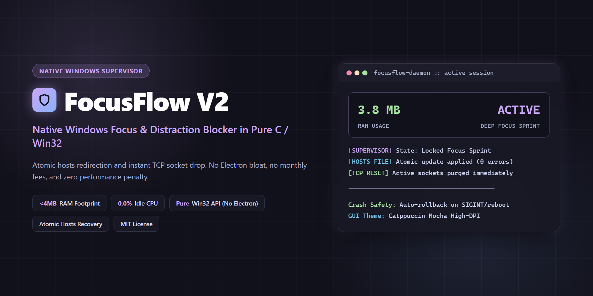

# FocusFlow v2.2

<p align="center">
  
</p>

<p align="center">
  <strong>Crash-Safe Deep Work Discipline Engine, Dual-Stack Atomic Hosts Blocker &amp; Catppuccin Mocha Desktop HUD.</strong><br>
  Engineered in Go and Python (zero external runtime dependencies) for developers, students, and operators who demand uncompromising focus without network corruption.
</p>

<p align="center">
  <a href="https://github.com/aloneangel45/FocusFlow/actions/workflows/ci.yml"></a>
  <a href="https://github.com/aloneangel45/FocusFlow/releases"></a>
  <a href="https://go.dev/"></a>
  <a href="https://python.org/"></a>
  <a href="https://opensource.org/licenses/MIT"></a>
  <a href="#"></a>
  <a href="#"></a>
</p>

---

## Why FocusFlow v2.2?

Conventional website blockers and browser extensions fail under real-world conditions:
1. **Trivial Extension Bypass:** Browser extensions can be disabled in seconds or bypassed via private windows and secondary browsers.
2. **IPv6 &amp; DNS-over-HTTPS (DoH) Leaks:** Single-stack `127.0.0.1` blockers leak traffic over IPv6 (`AAAA`) records and encrypted browser DoH resolvers (`cloudflare-dns.com`, `dns.google`, `dns.quad9.net`, `dns.nextdns.io`).
3. **Hosts File &amp; ACL Corruption:** Naive scripts overwrite `C:\Windows\System32\drivers\etc\hosts` in place without write-ahead journaling or Windows DACL preservation—breaking DNS resolution after power loss, crashes, or reboots.
4. **Heavy Runtime Dependencies:** Typical desktop wrappers pull hundreds of megabytes of packages just to enumerate processes.

**FocusFlow v2.2 solves these failure modes at the operating-system boundary:**
* **Unified Go CLI + Zero-Dependency Python HUD:** `cmd/focusflow` (Go) and `FocusFlowGUI.py` + `focusflow_core/` (Python stdlib + Win32 `ctypes`) share the exact same state directory, `config.json` (including custom named profiles and `daily_goal_minutes`), `sessions.json`, `hosts.focusflow.journal.json`, and managed block markers.
* **Custom Named Profiles, Daily Goals &amp; Multi-Cycle Pomodoro Engine:** Create validated custom workflow profiles (`focusflow profile create`), track daily focus targets (`focusflow goal`), and run multi-sprint Pomodoro blocks (`focusflow start --cycles 4 --break 5`) with automatic `hosts` shield pause between sprints (or continuous lockdown in `hardcore` mode).
* **Write-Ahead SHA-256 Rollback Journal &amp; Auto-Recovery:** Strips any prior managed blocks before computing a clean baseline SHA-256 backup, persists `hosts.focusflow.journal.json` before touching `hosts`, preserves Windows DACLs via `ReplaceFileW` (`NetworkService` / `Users` read permissions remain intact), and automatically recovers orphaned crash/reboot states on startup (`RecoverIfOrphaned`).
* **Dual-Stack IPv4 + IPv6 Sinkhole &amp; Expanded Anti-DoH:** Blocks both `0.0.0.0` and `::` (including `www.` subdomains) alongside major DoH bypass endpoints, with mid-session tamper verification and non-blocking DNS cache flushing.
* **Hardened Native Process Supervisor:** Uses Win32 `CreateToolhelp32Snapshot` (`Process32FirstW`/`Process32NextW`) on Windows (zero `psutil` required) and direct `/proc` inspection on Linux (resolving 15-byte `TASK_COMM_LEN` truncation without spawning `ps` every second), guarded by a strict critical system/host process denylist.
* **High-Friction Strict Mode &amp; Genuine Telemetry:** Features a non-pasteable 16-character alphanumeric Friction Challenge, `time.monotonic()` zero-drift countdowns, Per-Monitor v2 High-DPI Catppuccin Mocha HUD, and real streak/completion analytics exported to JSON, CSV, or PNG.

---

## Architecture

```text
+----------------------------------------------------------------------+
|       FocusFlow v2.2 CLI (Go)    <==>    Desktop HUD (Python/Tk)     |
+-----------------------------------+----------------------------------+
                                    |
          Shared State (%APPDATA%\FocusFlow or $FOCUSFLOW_HOME)
     [config.json | sessions.json | hosts.focusflow.journal.json]
                                    |
        +---------------------------+---------------------------+
        |                           |                           |
        v                           v                           v
+------------------+      +-------------------+      +--------------------+
| Dual-Stack Hosts |      | Native Supervisor |      | Real-Time Metrics  |
| SHA-256 + Journal|      | Win32 / Linux proc|      | Goals, Streak, CSV |
+--------+---------+      +---------+---------+      +--------------------+
         |                          |
         v                          v
 [System hosts File]       [Blocked Processes]
 (ACL-Safe Swap)           (Denylist-Guarded)
```

---

## Quick Start

### 1. One-Line Binary Install (SHA-256 Verified)

**Linux &amp; macOS (`amd64` / `arm64`):**
```bash
curl -fsSL https://raw.githubusercontent.com/aloneangel45/FocusFlow/main/install.sh | sh
```

**Windows PowerShell (`amd64` / `arm64`):**
```powershell
irm https://raw.githubusercontent.com/aloneangel45/FocusFlow/main/install.ps1 | iex
```
Both installers download `checksums.txt` from GitHub Releases and verify the archive SHA-256 digest prior to extraction. Pin a specific release with `FOCUSFLOW_VERSION=v2.2.0`.

### 2. Desktop HUD (Python 3.10+, Zero Required Packages)
Launch `Launch_FocusFlow_GUI.bat` on Windows or run directly:
```bash
python FocusFlowGUI.py
```
To launch directly with Administrator elevation prompt on Windows:
```bash
python FocusFlowGUI.py --elevate
```
*(Optional)* For PNG chart card rendering, install `Pillow`: `pip install .[reports]`.

### 3. Build Native Standalone CLI from Source (Go 1.23+)
```bash
CGO_ENABLED=0 go build -trimpath -ldflags="-s -w -X main.Version=2.2.0" -o focusflow ./cmd/focusflow
```

---

## CLI Reference

> **Privilege Model:** Modifying the system `hosts` file requires Administrator (`Windows`) or `root` (`Linux`/`macOS`) privileges. When run unprivileged, FocusFlow honestly reports `PROCESS-ONLY [UNPRIVILEGED]` rather than claiming `hosts` is locked. Pass `--elevate` to request privilege elevation.

```bash
# Launch interactive terminal dashboard
focusflow menu

# Start a 50-minute Developer sprint (elevating via UAC/sudo if needed)
focusflow start --profile dev --minutes 50 --elevate

# Multi-cycle Pomodoro: 4 cycles of 25m work + 5m recovery break
focusflow start --profile study --cycles 4 --break 5 --elevate

# Hardcore Aegis multi-cycle sprint (lockdown stays continuous across breaks)
focusflow start --profile hardcore --cycles 2 --break 5 --strict hardcore

# Create, inspect, list, and delete custom named profiles
focusflow profile list
focusflow profile create writer --from study --minutes 45 --break 10 --sites news.ycombinator.com,medium.com --apps slack.exe --desc "Distraction-free writing"
focusflow profile show writer --json
focusflow profile delete writer

# View or configure your daily focus goal (5..1440 minutes)
focusflow goal
focusflow goal --minutes 180
focusflow goal --json

# Inspect shield capability, daily goal progress, and active journal
focusflow status
focusflow status --json

# Manage global custom RFC-1123 domains and denylist-checked executables
focusflow list --json
focusflow add site reddit.com
focusflow add app steam.exe
focusflow remove site reddit.com

# View genuine focus hours, daily goal progress, completion rate, streak & 7-day ASCII chart
focusflow stats --days 7
focusflow stats --days 7 --json

# Export telemetry to JSON or CSV
focusflow export --format json --out focus_report.json
focusflow export --format csv --out focus_sessions.csv

# Run system diagnostics or recover orphaned crash/reboot state
focusflow doctor
focusflow doctor --json
focusflow recover --elevate

# Immediate rollback & DNS cache flush
focusflow stop
focusflow flush
```

---

## Built-in Profiles

| Profile | Default Interval | Target Workflow | Active Protections |
| :--- | :--- | :--- | :--- |
| **`study`** | `25m / 5m` | Academic &amp; Exam Prep | Blocks video, social, streaming, chat clients, and game launchers |
| **`dev`** | `50m / 10m` | Software Engineering | Keeps GitHub, StackOverflow &amp; technical docs open; blocks social &amp; gaming |
| **`hardcore`** | `25m / 5m` | Aegis Lockdown | Study blocklist + strict Friction Challenge + Anti-Cheat task-manager suppression (`taskmgr.exe`, `SystemInformer.exe`, `processhacker.exe`) |

---

## Crash Safety &amp; System Integrity

* **Clean Baseline Guarantee:** FocusFlow strips any current or legacy managed blocks before hashing and writing `hosts.focusflow.bak`, ensuring a contaminated `hosts` file is never backed up.
* **Write-Ahead Rollback Journal:** `hosts.focusflow.journal.json` records `original_sha256`, `backup_path`, `hosts_path`, `session_id`, `pid`, `started_at`, `expected_end_at`, and `profile` prior to any `hosts` write.
* **Automatic Startup Recovery:** On every CLI or GUI startup, `RecoverIfOrphaned` checks whether a prior session crashed, rebooted, or expired; verifies `.bak` against `original_sha256` (falling back to deterministic marker stripping if `.bak` was altered); restores `hosts` while preserving OS permissions/ACLs; and marks the interrupted session `completed: false` in `sessions.json`.
* **Critical Process Denylist:** Kernel, session, shell, and host binaries (`csrss.exe`, `lsass.exe`, `svchost.exe`, `explorer.exe`, `dwm.exe`, `winlogon.exe`, `python.exe`, `pythonw.exe`, `focusflow.exe`, `wt.exe`, PIDs `0`/`4`/self/parent) can never be added or terminated.

---

## Testing

All Go and Python tests run hermetically inside temporary `FOCUSFLOW_HOME` and `FOCUSFLOW_HOSTS_PATH` sandboxes—never touching your real `%APPDATA%` or system `hosts` file:

```bash
go vet ./...
go test -v ./...
python -m pytest -v
```

---

## License

Released under the [MIT License](LICENSE) by [aloneangel45](https://github.com/aloneangel45).
